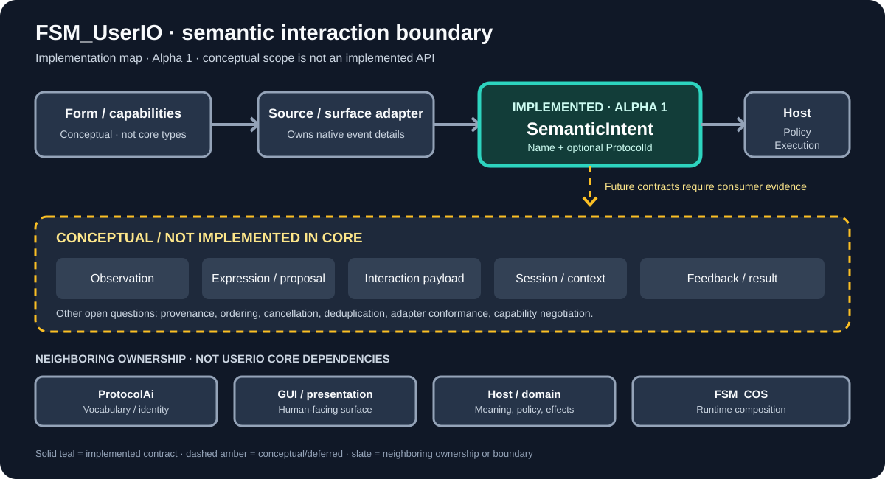
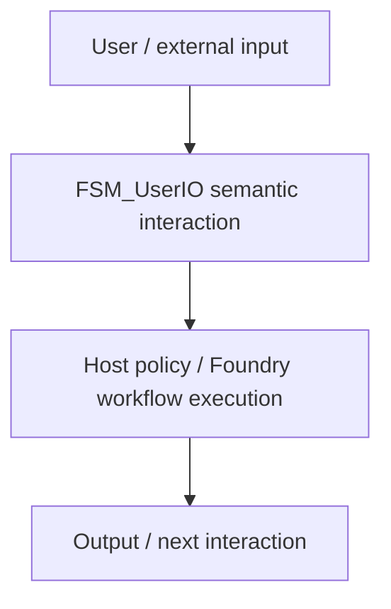
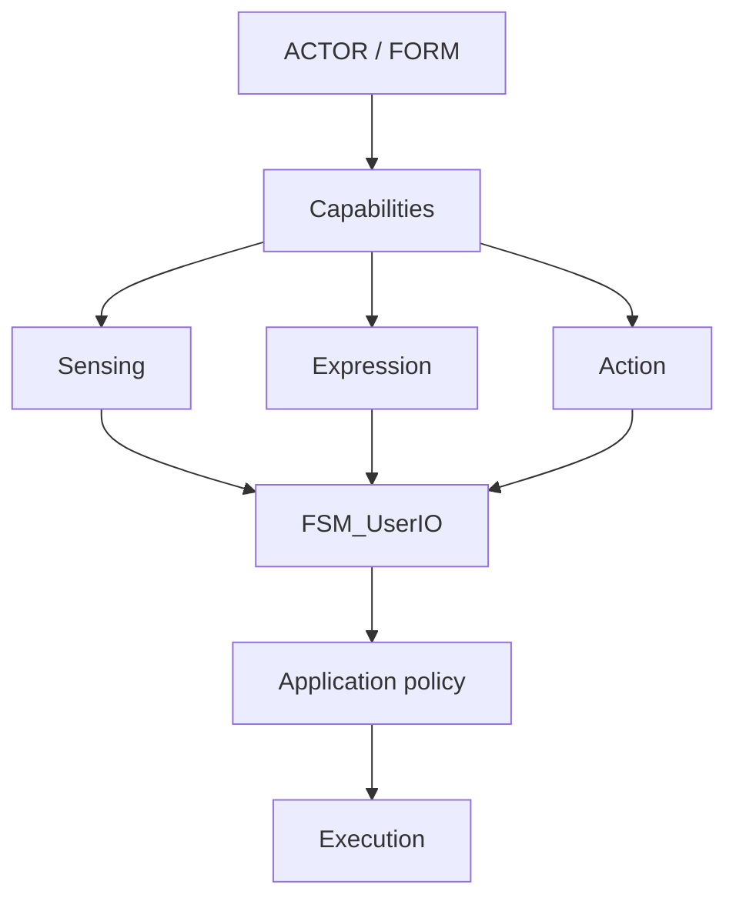
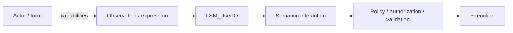
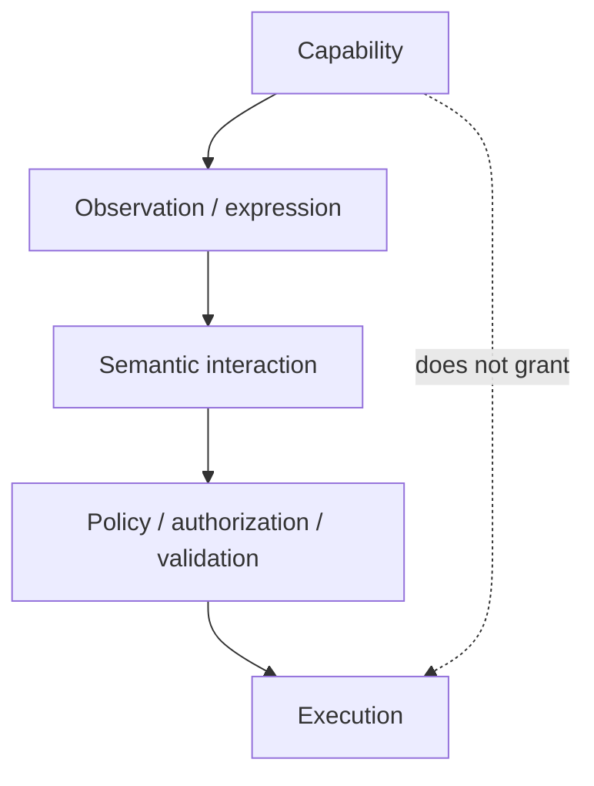
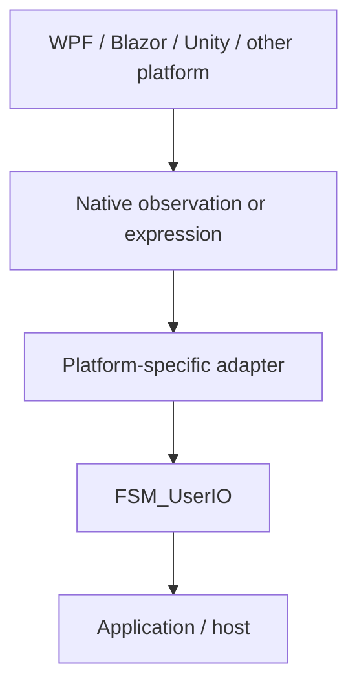
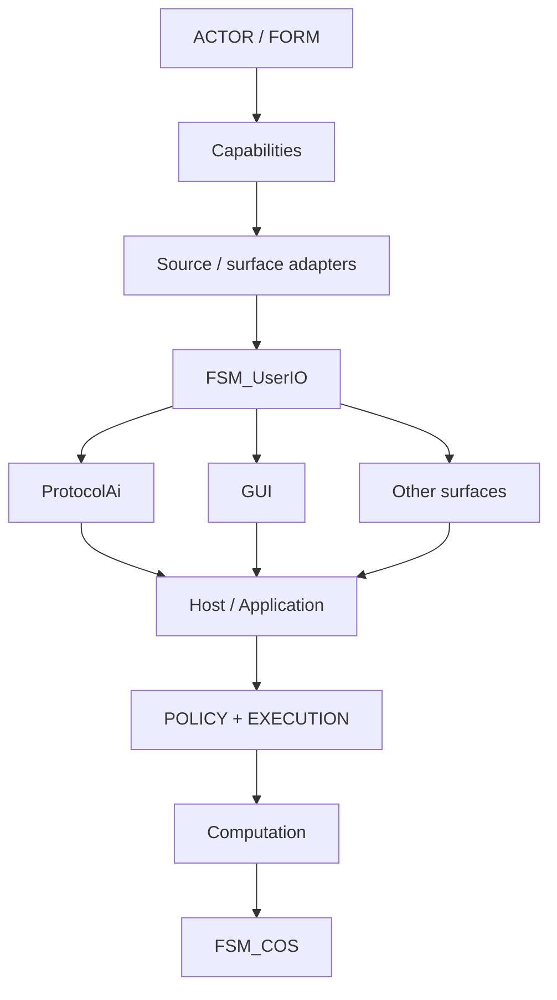

<!-- The Singularity Workshop moniker -->
<p align="center"><a href="https://github.com/TrentBest"></a></p>

# TheSingularityWorkshop.FSM_UserIO

[](https://www.nuget.org/packages/TheSingularityWorkshop.FSM_UserIO)
[](https://www.nuget.org/packages/TheSingularityWorkshop.FSM_UserIO)
[](https://github.com/TrentBest/FSM_UserIO/actions/workflows/build.yml)
[](https://codecov.io/gh/TrentBest/FSM_UserIO)
[](LICENSE.txt)
[](https://github.com/TrentBest/FSM_UserIO/commits/master)
[](https://github.com/TrentBest/FSM_UserIO/issues)
[](https://dotnet.microsoft.com/)


> **Platform-neutral contracts for user-facing input and output capabilities.**



**[Gallery](docs/GALLERY.md)** — semantic maps, contract examples, and proposed executable traces

**[Audio Capture Lab](docs/demos/audio-capture-lab.html)** — interactive browser prototype for microphone/system-audio permissions, the green → magenta countdown → red recording border, capture, playback, and download. Requires HTTPS or localhost; source availability depends on browser and operating system.

**[Audio capture source contract](docs/AUDIO_CAPTURE_CONTRACT.md)** — source-neutral lifecycle states and transition rules.

**[Windows system-audio loopback decision](docs/WINDOWS_SYSTEM_AUDIO_LOOPBACK.md)** — adapter boundary, privacy constraints, lifecycle mapping, and verification gates.

**[Windows loopback sample](samples/WindowsLoopbackSample/README.md)** — runnable .NET 8 sample and real-device verification checklist.

**[Audio Capture Lab verification guide](docs/demos/AUDIO_CAPTURE_TESTING.md)** — manual test matrix for normal capture, denial/cancellation, missing tracks, source loss, retries, and repeated sessions.

User interaction is a capability boundary, not authority by itself. A host may collect input or present output while authorization and application decisions remain elsewhere.



## 🟦 01 What

The current `development` source exposes platform-neutral contracts for `SemanticIntent`, descriptive capabilities, observations, expressions, opaque payloads, correlation context, and semantic feedback. The [API contract](docs/API_CONTRACTS.md) documents their invariants and non-guarantees. The published `0.1.0-alpha.1` package remains the earlier `SemanticIntent`-only baseline until a future release is explicitly authorized and published.

## 🟣 02 Why

Input and output are reusable capabilities, but capability must not be confused with authority. Separating the interaction contract from host policy makes it possible to change presentation without accidentally granting user-facing components permission to perform application actions.

## 🔺 03 How

Describe the interaction capability separately from platform-specific UI, then connect a suitable adapter or host. The package does not grant a capability permission to perform unrelated actions.

## 🟢 04 See it in a minute

Try the currently published Alpha 1 package in a clean .NET 8 console app. This demonstrates the API actually available from NuGet today; the expanded contracts are present in `development` source and will not be available to package consumers until a separately authorized release.

Create a console app and add the package:

```powershell
dotnet new console --framework net8.0
dotnet add package TheSingularityWorkshop.FSM_UserIO --version 0.1.0-alpha.1
```

Replace `Program.cs` with:

```csharp
using TheSingularityWorkshop.FSM_UserIO;

var intent = new SemanticIntent("open-settings");

Console.WriteLine(intent.Name);
Console.WriteLine(intent.ProtocolId is null ? "No protocol identity" : intent.ProtocolId);
```

Run it with `dotnet run`. Expected output:

```text
open-settings
No protocol identity
```

The optional `ProtocolId` is an association value; it does not authenticate the sender or authorize the requested action. See the [API contract](docs/API_CONTRACTS.md) for validation and equality behavior.

## 🟪 05 Documentation and theory

[The vision](#the-vision) · [Capability is the important abstraction](#capability-is-the-important-abstraction) · [Documentation](#documentation)

---

## Detailed guide

**The Singularity Workshop UserIO boundary: semantic interaction across forms, capabilities, observations, expression, and computation.**

FSM_UserIO is a platform-neutral semantic interaction boundary. It is not a human-input library, a game-engine input layer, or a GUI event abstraction.

The package begins from a more fundamental question:

> **What can the interacting form sense, express, or perform, and what semantic interaction does that capability produce?**

A human is one possible form. A dog is another. A robot, VR avatar, accessibility system, AI agent, remote operator, or software process can also be an interacting form. The common abstraction is not anatomy and it is not a device. It is **capability**.

## The vision

The Workshop does not want UserIO constrained by the conventions of Unity, WPF, Blazor, another game engine, or the human keyboard-and-mouse model.

Those are manifestations of computation.

FSM_UserIO sits at the semantic boundary beneath them:



The upper limit is therefore not "what a human can do with a controller" or "what Unity exposes." The boundary is constrained by the capabilities that can be represented and by the computation that can process them.

## Why this package exists

A keyboard key, mouse movement, controller button, paw gesture, gaze event, voice utterance, accessibility action, automation signal, software message, or AI proposal is **not itself application meaning**.

It is an observation, expression, or proposal produced through some capability.

FSM_UserIO exists to carry the semantic interaction across that boundary without taking ownership of the source, the GUI, the datum, or execution.



That gives the Workshop a stable separation:

| Concern | Owner |
|---|---|
| Actor/form and its real capabilities | originating system / application |
| Physical or software observation | source adapter |
| Semantic interaction | FSM_UserIO |
| Deterministic semantic identity | ProtocolAi |
| Structural composition | GrammarAi |
| Human-facing semantic presentation | GUI |
| Domain datum and domain meaning | application/domain |
| Policy, authorization, validation, execution | host/application |
| Runtime composition | FSM_COS |
| Native manifestation/rendering | platform-specific package |

## Capability is the important abstraction

Capability is broader than input.

A capability can describe what a form can **sense**, **express**, or **perform**.

Examples are intentionally illustrative rather than an ontology:

| Form | Possible capabilities |
|---|---|
| Human | vision, hearing, speech, grasping, locomotion, typing |
| Dog | vision, hearing, smell, barking, biting, locomotion |
| Robot | sensors, locomotion, manipulation, speech, network interaction |
| VR avatar | application-granted perception, locomotion, manipulation, expression |
| AI agent | semantic observation, proposal, planning, software interaction |
| Software process | messages, API calls, files, events, service operations |
| Accessibility system | gaze, switches, speech, specialized controls |

The point is **not** to encode these examples as a giant universal capability enum.

The point is to avoid making the core accidentally assume that every user is a biped holding a controller.

### Capability is not authority

A capability does not grant permission.

A dog may be physically capable of biting. A human may be capable of deleting a record. An AI agent may be capable of proposing `DeleteAccount`. A software process may be capable of invoking an API.

Whether any of those interactions are meaningful, permitted, authorized, or executable belongs to application policy.



This separation is fundamental to the package.

## What FSM_UserIO is not

FSM_UserIO is deliberately **not**:

- a keyboard or mouse API;
- a controller abstraction;
- a WPF input framework;
- a Blazor event framework;
- a Unity input layer;
- a game-engine abstraction;
- a device SDK;
- a rendering system;
- a GUI widget library;
- an authorization system;
- an application command executor;
- a replacement for ProtocolAi or GrammarAi.

Those concerns may have adapters or bridge packages. They do not belong in the semantic core merely because one consumer happens to need them.

## Platform independence

Do **not** read "UserIO" as "human I/O."

The name describes the application boundary through which an interacting form reaches semantic interaction.

Likewise, do not assume that every platform needs a package named `WPF_IO`, `Blazor_IO`, or `Unity_IO`. A platform-specific adapter should exist only when a real shared contract justifies it.



If several platforms share a capability, the shared bridge belongs at the smallest boundary that actually owns that capability. This is the same minimum-intersection principle used elsewhere in the Workshop.

## The Workshop stack

FSM_UserIO does not replace the other Workshop packages. It gives them a clean boundary to meet at:



ProtocolAi can give application-owned symbols deterministic identity.

GrammarAi can describe how those identities are structurally composed.

GUI can mediate human-facing presentation and interaction with datum.

FSM_COS can compose runtime capabilities. Foundry owns the Hub's authoritative workflow execution pipeline; FSM_UserIO supplies interaction primitives and does not schedule workflows or own run state. GUI is an optional presentation manifestation when the Hub chooses to present itself.

None of those relationships require FSM_UserIO to depend upward on them.

## Alpha 1

Alpha 1 deliberately starts with one semantic artifact:

```csharp
public sealed record SemanticIntent(string Name, ulong? ProtocolId = null);
```

This is intentionally small.

It establishes that an application-owned semantic interaction can have:

- a required application-defined name;
- an optional deterministic numeric identity;
- no embedded device type;
- no GUI type;
- no rendering type;
- no authorization policy;
- no execution behavior.

The package will grow only when a real boundary requires another contract and that contract can be demonstrated with tests and a consumer.

## Documentation

Start with:

- [Theory](docs/THEORY.md) — the conceptual boundary and capability model.
- [Interaction lifecycle](docs/INTERACTION_LIFECYCLE.md) — the path from observation to host policy, execution, and feedback.
- [API contracts](docs/API_CONTRACTS.md) — source contracts, validation rules, release availability, and explicit non-guarantees.
- [Gallery](docs/GALLERY.md) — semantic boundary diagrams and a tested-contract evidence trace.
- [Architecture](docs/ARCHITECTURE.md) — ownership and dependency direction.
- [Development](docs/DEVELOPMENT.md) — contribution and design rules.
- [Roadmap](docs/ROADMAP.md) — deliberately staged API evolution.
- [Implementation roadmap](docs/IMPLEMENTATION_ROADMAP.md) — domain definition, open decisions, integration opportunities, and release checklist.
- [Alpha readiness](docs/ALPHA_READINESS.md) — the Alpha 1 release gate.
- [Alpha 2 readiness](docs/0.1.0-alpha.2-READINESS.md) — provisional next-release gates; the package version remains Alpha 1 until separately approved.
- [Domain completion criteria](docs/DOMAIN_COMPLETION_CRITERIA.md) — evidence required to call the package complete without inventing speculative API.
- [Integration walkthrough](docs/INTEGRATION_WALKTHROUGH.md) — runnable adapter → intent → host-decision example using the published Alpha 1 contract.
- [Ownership matrix](docs/OWNERSHIP_MATRIX.md) — which package, adapter, or host owns each neighboring concern.

The documentation is part of the API. It exists to prevent future consumers from accidentally importing a game-engine or human-device interpretation into a package intended to remain computation-bound rather than platform-bound.

## NuGet publication

Alpha 1 (`0.1.0-alpha.1`) is published on NuGet; see the [package page](https://www.nuget.org/packages/TheSingularityWorkshop.FSM_UserIO/0.1.0-alpha.1).

Future publication remains opt-in. The workflow can publish only when manually dispatched on `development` with the `publish` input explicitly set to `true`, after the verification job succeeds. Ordinary pushes and pull requests build, test, measure coverage, package, and verify a clean consumer without publishing. A successful CI run or package artifact is not publication authorization.

The release procedure is documented in the Workshop's [NuGet Publication Runbook](https://github.com/TrentBest/TheSingularityWorkshop.FSM_COS/blob/master/docs/RELEASING.md).

## License

MIT. See [LICENSE.txt](LICENSE.txt).

---

<!-- THE SINGULARITY WORKSHOP FOOTER -->
<p align="center"></p>
