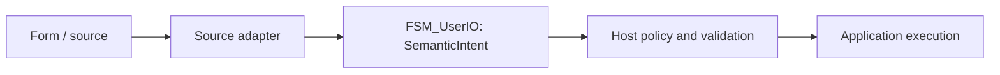

<!-- The Singularity Workshop moniker -->
<p align="center">
  <a href="https://github.com/TrentBest">
    
  </a>
</p>

# ✳️ 00 TheSingularityWorkshop.FSM_UserIO

[](https://www.nuget.org/packages/TheSingularityWorkshop.FSM_UserIO)
[](https://www.nuget.org/packages/TheSingularityWorkshop.FSM_UserIO)
[](https://github.com/TrentBest/FSM_UserIO/actions/workflows/build.yml)
[](https://codecov.io/gh/TrentBest/FSM_UserIO)
[](LICENSE.txt)
[](https://github.com/TrentBest/FSM_UserIO/commits/master)
[](https://dotnet.microsoft.com/)

<p align="center">
  
</p>

## 🟦 01 What

**FSM_UserIO is the platform-neutral semantic interaction boundary between a participating form's capabilities and application-owned meaning.**

A human, robot, accessibility surface, AI agent, remote operator, or software process may produce an interaction. A keyboard event, gaze signal, sensor reading, voice utterance, or message is a source manifestation—not application meaning by itself.

Alpha 1 provides one small core contract:

`SemanticIntent(string Name, ulong? ProtocolId = null)`

It preserves an application-defined semantic name and optionally carries a deterministic protocol identity. The core has no runtime package dependencies.

## 🟣 02 Why

Applications should not need to redefine semantic meaning for every input device, GUI framework, or participating form. Nor should a device event silently become an authorized action.

UserIO separates semantic interaction from its source and from the host's policy. A capability does not grant authority; an intent does not execute itself. The application remains responsible for interpretation, validation, authorization, and effects.

## 🩵 03 How



- **Adapters** own device, framework, and source-specific event types.
- **FSM_UserIO** carries semantic intent without owning the originating form or deciding what the intent permits.
- **ProtocolAi** owns deterministic vocabulary identity; `ProtocolId` is only an optional association slot here.
- **GUI** owns human-facing presentation. **FSM_COS** owns runtime composition.
- **The host/application** owns domain meaning, policy, authorization, validation, and execution.

Observation, expression/proposal, payload, session, feedback, and adapter-conformance contracts remain design questions—not implemented Alpha 1 APIs. The complete inventory and the implementation/deferred distinction are in the [domain completion roadmap](docs/ROADMAP.md).

## 🟢 04 See it in a minute

With .NET 8 installed, create a console app and add the published Alpha 1 package:

```powershell
dotnet new console --framework net8.0
dotnet add package TheSingularityWorkshop.FSM_UserIO --version 0.1.0-alpha.1
```

Replace `Program.cs` with:

```csharp
using TheSingularityWorkshop.FSM_UserIO;

var intent = new SemanticIntent("open-settings");

Console.WriteLine(intent.Name);
Console.WriteLine(intent.ProtocolId is null ? "No protocol identity" : intent.ProtocolId);
```

Expected output:

```text
open-settings
No protocol identity
```

This creates a semantic value. It does **not** authorize or execute an operation. The host decides what `open-settings` means and whether it is allowed.

## 🟪 05 Available documentation and theory

- [Theory](docs/THEORY.md) — why capability, observation, expression, intent, authority, and execution must remain distinct.
- [Architecture](docs/ARCHITECTURE.md) — responsibility ownership, dependency direction, and explicit non-ownership.
- [Domain completion roadmap](docs/ROADMAP.md) — full domain inventory, implemented-versus-deferred status, unresolved decisions, and completion gates.
- [API contracts](docs/API_CONTRACTS.md) — exact Alpha 1 `SemanticIntent` behavior and non-guarantees.
- [Development](docs/DEVELOPMENT.md) — build, test, coverage, packaging, and rules for proposing new contracts.
- [Alpha readiness](docs/ALPHA_READINESS.md) — release evidence required for the deliberately small Alpha 1 API.
- [Workshop documentation standard](https://github.com/TrentBest/TheSingularityWorkshop.FSM_COS/blob/master/DOCUMENTATION_STANDARD.md) — shared README sequence and documentation quality rules.

## Domain boundary at a glance

FSM_UserIO deliberately does **not** own physical devices, native UI events, GUI widgets, actor ontologies, application datum, authorization, execution, network transport, or runtime composition. Platform-specific adapters may depend on the core; the core must not depend upward on adapters or neighboring Workshop packages.

The design rule is: **define the smallest semantic boundary that can serve the largest computational design space.** Expand the API only when a real consumer demonstrates a shared contract with clear ownership and testable invariants.

---

<p align="center"><em>The Singularity Workshop — edify, don't mystify.</em></p>
