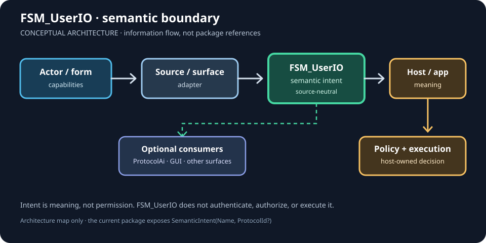
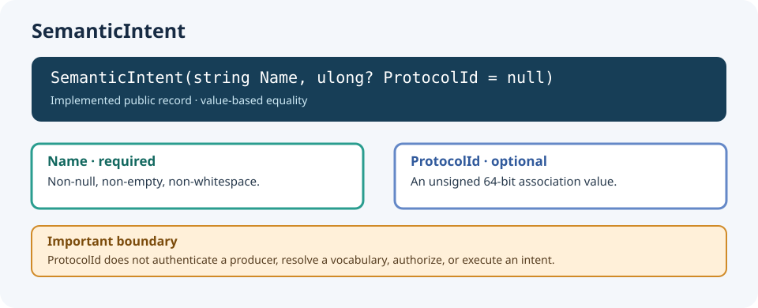

# FSM_UserIO Gallery

**Make interaction meaning visible without making the core depend on a device, GUI, or game engine.**

A functionality gallery does not need to pretend that a package is a visual renderer. For FSM_UserIO, the useful pictures are **semantic maps and executable traces**: show what information crosses the boundary, what stays outside it, and which claims are implemented versus conceptual.

The package currently exposes one public domain type: `SemanticIntent(Name, ProtocolId?)`. The SVG concepts below should be generated from the documented contract and test fixtures when implemented; they must not imply that future capabilities already exist.

## 01 — The semantic boundary

This SVG is an explicitly conceptual responsibility map: arrows represent information flow, not package dependencies. It makes the important distinction visible between semantic intent and host-owned policy/execution.

**What it explains:** FSM_UserIO carries source-neutral semantic interaction. It does not own devices, UI presentation, authorization, validation, or execution.

**Read the full recipe:** [Architecture and ownership](ARCHITECTURE.md).

## 02 — SemanticIntent: the smallest truthful specimen

This SVG describes the implemented record contract: required non-whitespace `Name`, optional `ProtocolId`, and value equality over both properties. It is a contract illustration, not runtime telemetry. The numeric association does not authenticate, authorize, or globally resolve an intent.

**What it explains:** the implemented public contract and its validation boundary.

**Read the full recipe:** [API contracts](API_CONTRACTS.md).

## 03 — Proposal is not permission

**Proposed SVG:** two distinct lanes: “semantic proposal” and “host policy/execution.” A proposed intent crosses into the host, where application-owned policy decides what happens. A denied or invalid proposal must visibly stop before execution. Mark this as an architectural boundary, not an implemented authorization subsystem.

**What it explains:** why capability, intent, permission, and execution must not be collapsed into one concept.

**Read the full recipe:** [Architecture](ARCHITECTURE.md) · [Theory](THEORY.md).

## 04 — From tests to a living trace

**Proposed SVG:** a deterministic test fixture emits a compact trace showing construction of valid `SemanticIntent`, rejection of null/empty/whitespace names, optional protocol association, and value equality. Every visual state should be sourced from the test output or shared fixture—not a separately hand-authored claim.

**What it explains:** how a functionality package can have visual evidence without inventing a GUI or runtime features.

**Read the full recipe:** [API contracts](API_CONTRACTS.md) · [Development](DEVELOPMENT.md).

## Evidence rule

Until these SVGs are generated from shared fixtures or test output, they are design recipes—not implemented gallery artifacts. Keep that label visible. FSM_UserIO has no runtime package dependencies, and it must stay independent of ProtocolAi, GUI, FSM_COS, WPF, Blazor, Unity, and device SDKs.

---

[Roadmap](ROADMAP.md) · [Implementation roadmap](IMPLEMENTATION_ROADMAP.md) · [Alpha readiness](ALPHA_READINESS.md)
