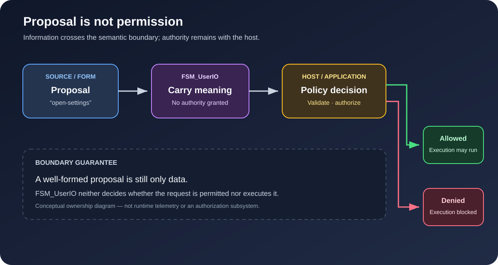
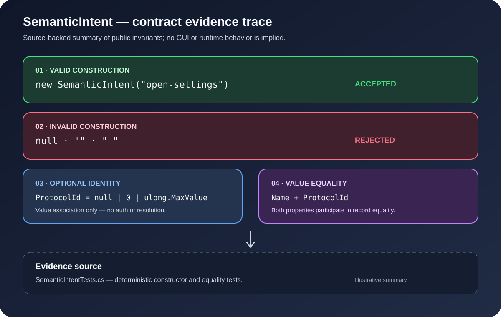

<!-- The Singularity Workshop moniker -->

# FSM_UserIO Gallery

**Make interaction meaning visible without making the core depend on a device, GUI, or game engine.**

For FSM_UserIO, the useful pictures are **semantic maps and contract evidence traces**: show what information crosses the boundary, what stays outside it, and which claims are implemented versus conceptual.

The `development` source exposes semantic capability, observation, expression, intent, payload, context, and feedback contracts. The published Alpha 1 package remains `SemanticIntent`-only. These visuals describe contract boundaries and tested invariants; they do not imply runtime behavior that the contracts do not provide.

## 01 — The semantic boundary

This SVG is an explicitly conceptual responsibility map: arrows represent information flow, not package dependencies. It makes the important distinction visible between semantic intent and host-owned policy/execution.

**What it explains:** FSM_UserIO carries source-neutral semantic interaction. It does not own devices, UI presentation, authorization, validation, or execution.

**Read the full explanation:** [Architecture and ownership](ARCHITECTURE.md).

## 02 — SemanticIntent: the smallest truthful specimen

This SVG describes the implemented record contract: required non-whitespace `Name`, optional `ProtocolId`, and value equality over both properties. It is a contract illustration, not runtime telemetry. The numeric association does not authenticate, authorize, or globally resolve an intent.

**What it explains:** the implemented public contract and its validation boundary.

**Read the full explanation:** [API contracts](API_CONTRACTS.md).

## 03 — Proposal is not permission

This conceptual ownership diagram shows a proposal crossing the UserIO boundary into host policy. The host can permit execution or deny the request. FSM_UserIO carries meaning but does not authorize or execute the proposal. The diagram describes responsibility boundaries, not an implemented authorization subsystem or runtime telemetry.

**What it explains:** why capability, intent, permission, and execution must not be collapsed into one concept.

**Read the full explanation:** [Architecture](ARCHITECTURE.md) · [Theory](THEORY.md).

## 04 — SemanticIntent contract evidence

This visual summarizes deterministic contract cases covered by `SemanticIntentTests.cs`: valid construction, rejection of null/empty/whitespace names, optional protocol identity, and record value equality. It is an authored summary of test cases, not an SVG generated by executing the test suite. CI test results remain the authority for whether those tests pass on a particular commit.

**What it explains:** how contract evidence can be made visible without inventing a GUI or runtime features.

**Read the full explanation:** [API contracts](API_CONTRACTS.md) · [Development](DEVELOPMENT.md).

## Evidence rule

The boundary and proposal diagrams are conceptual responsibility maps. The contract trace summarizes named tests and is not runtime telemetry. Keep those distinctions visible. FSM_UserIO has no runtime package dependencies, and it must stay independent of ProtocolAi, GUI, FSM_COS, WPF, Blazor, Unity, and device SDKs.

---

[Roadmap](ROADMAP.md) · [Implementation roadmap](IMPLEMENTATION_ROADMAP.md) · [Alpha readiness](ALPHA_READINESS.md)

---

<!-- THE SINGULARITY WORKSHOP FOOTER -->

