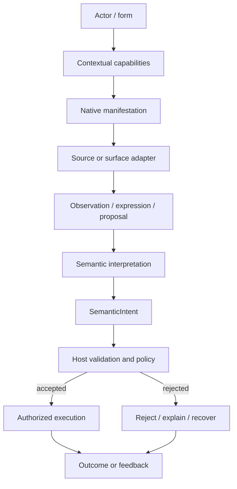

<!-- The Singularity Workshop moniker -->
<p align="center">
  <a href="https://github.com/TrentBest">
    
  </a>
</p>

# UserIO Interaction Lifecycle

**Purpose:** explain how an observation from any participating form can become a semantic interaction—and why that does not, by itself, authorize or execute anything.

This document describes the domain model. It does not claim that every stage below is already represented by a public FSM_UserIO type. The implemented API is documented separately in [API Contracts](API_CONTRACTS.md).

## 1. The lifecycle at a glance



The `development` source implements `SemanticIntent`, `InteractionCapability`, `SemanticObservation`, `SemanticExpression`, `InteractionContext`, and `SemanticFeedback`. Policy, authorization, execution, device adapters, transport, and runtime composition remain outside core. The published Alpha 1 package still exposes only `SemanticIntent`.

## 2. Separate the concepts

| Concept | Question it answers | Owner |
|---|---|---|
| Actor / form | What entity or computational representation is participating? | Source system or host |
| Capability | What can this form sense, express, or perform in this context? | Source system, environment, or host |
| Manifestation | Through what physical, virtual, or software mechanism does it occur? | Platform / adapter |
| Observation | What was detected or reported? | Source and adapter |
| Expression / proposal | What is being communicated or proposed? | Source and adapter; trust policy remains with host |
| Semantic intent | What application-owned interaction is being identified? | Application vocabulary, carried by UserIO |
| Protocol identity | Which application-defined symbol is associated with it? | Application / protocol; UserIO only carries an optional numeric value |
| Validation and authorization | Is this interaction valid and permitted now? | Host / application |
| Workflow lifecycle | Which workflow is running, what state is it in, and how is it coordinated? | Foundry / Hub host |
| Execution | What state change or operation actually occurs? | Host / runtime selected by Foundry / application policy |
| Outcome / feedback | What happened, and what should the participant be told? | Host and presentation surface |

Do not collapse these into one object simply because a first consumer can represent them with one string.

## 3. Observation is not interpretation

A source event is evidence, not meaning.

For example, a button press might mean `select` in one context, `confirm` in another, or nothing in a third. A gaze fixation, voice recognition result, robot sensor reading, service event, or AI proposal has the same distinction: the source reports something; the application interprets it under its own context and rules.

The adapter should remove source-specific mechanics without pretending that it owns application policy. The semantic name should be selected by the application vocabulary, not inferred by FSM_UserIO from a particular device.

## 4. Capability is contextual—and not authority

Capability means that a form can sense, express, or perform something under some set of conditions. It is not a grant of permission.

A robot actuator can exist while the host disallows movement. A human can request deletion without having permission to delete. An AI system can propose an operation without being trusted to perform it.

Keep these invariants:

- Capability does not imply authorization.
- Observation does not imply acceptance.
- A well-formed intent does not imply valid domain state.
- A protocol ID does not prove identity, provenance, or trust.
- Grammar or structural validity does not grant permission.
- Only the host's policy and execution boundary can authorize and perform an operation.

## 5. The current API: intentionally small

```csharp
using TheSingularityWorkshop.FSM_UserIO;

var intent = new SemanticIntent("document.open", ProtocolId: null);
```

`SemanticIntent` currently provides an application-defined, non-blank `Name` and an optional `ulong?` `ProtocolId`. The name is preserved exactly; equality is value-based and includes both properties. A missing protocol identity is valid.

The core does not resolve IDs, normalize application vocabulary, infer intent from events, carry arbitrary payloads, authenticate producers, authorize requests, or execute commands. See [API Contracts](API_CONTRACTS.md) for the precise constructor and equality contract.

## 6. A safe host-side pattern

The following is pseudocode, not a public UserIO API:

```text
native event or message
    -> adapter translates source mechanics
    -> application maps it to a SemanticIntent
    -> host checks context, domain validity, and authorization
    -> host executes only if accepted
    -> host reports the outcome through its chosen surface
```

Keep rejection as a normal outcome. A rejected intent should not require the source adapter to know why the domain operation was denied; the host can provide an appropriate response through GUI, speech, a service response, or another surface.

## 7. Input and output are not necessarily symmetric

“Input/output” can suggest that every input has a matching output object. The domain does not require that assumption.

An observation may be ignored, combined with other evidence, or result in a rejection. One intent may produce several effects or no visible feedback. Output may be a GUI update, a spoken response, a robot action, a protocol message, or no output at all.

Therefore, do not add a universal response type merely to make the names symmetrical. First establish a real consumer need and determine whether the response belongs to UserIO, the host, a protocol, or a presentation layer.

## 8. Questions to resolve only when consumers require them

These are open domain questions, not implemented contracts:

- **Provenance:** who or what produced a proposal, and how can the host assess that evidence?
- **Ordering and correlation:** when multiple observations arrive, who owns timestamps, sequence, causality, and request correlation?
- **Payload:** does a semantic interaction need data, and should that data belong to the domain, protocol, serialization layer, or an application envelope?
- **Context:** who owns actor, session, experience, and capability context?
- **Trust:** how are untrusted proposals represented and checked without confusing confidence with authorization?
- **Feedback:** does a reusable response contract exist across real consumers, or is feedback correctly host/surface-specific?
- **Adapter conformance:** do multiple real adapters need the same testable contract?

For each proposed API addition, identify a real consumer, name the semantic owner, demonstrate platform-neutral meaning, and add tests for the invariant. If those conditions are not met, keep the concept documented rather than freezing it into the public API.

## 9. Relationship to the Workshop

- **FSM_UserIO:** carries the semantic interaction boundary.
- **ProtocolAi:** can supply deterministic identity for application-owned symbols; UserIO does not require a runtime dependency on it.
- **GrammarAi:** can describe structural relationships; structure is not authorization.
- **GUI:** mediates human-facing presentation and interaction with domain datum.
- **Host / application:** owns context, domain meaning, validation, authorization, and the decision to execute.
- **Foundry / Hub host:** owns the authoritative Hub workflow execution pipeline and run state. UserIO must not duplicate workflow scheduling or lifecycle.
- **GUI:** is an optional presentation manifestation when the Hub chooses to present itself; it is not required by UserIO.
- **FSM_COS:** composes runtime capabilities; it does not need to become a dependency of this semantic core.

These are ownership boundaries, not claims that the packages directly reference one another.

## See also

- [README](../README.md) — purpose and entry point.
- [Theory](THEORY.md) — the capability-first model.
- [Architecture](ARCHITECTURE.md) — ownership and dependency direction.
- [API Contracts](API_CONTRACTS.md) — the implemented public API.
- [Roadmap](ROADMAP.md) — established work and unresolved decisions.
- [Alpha readiness](ALPHA_READINESS.md) — release verification gates.

---

<p align="center">
  <em>The Singularity Workshop — edify, don't mystify.</em>
</p>
