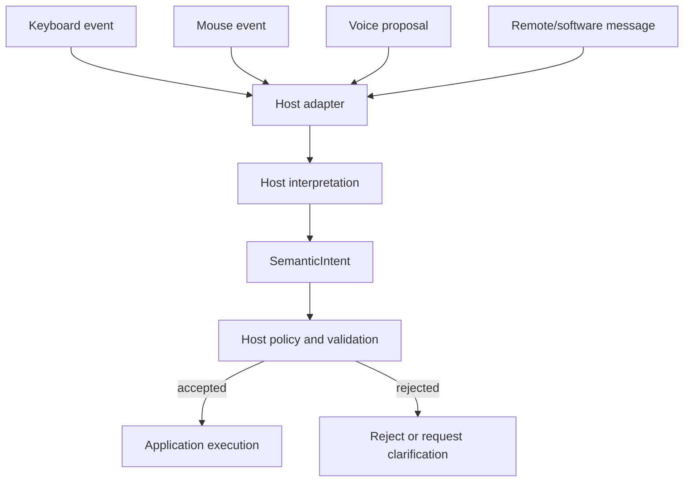

<!-- The Singularity Workshop moniker -->
<p align="center"><a href="https://github.com/TrentBest"></a></p>

# 01 — What Is Semantic Interaction?

## 1. Intuition: the event is not the meaning

Imagine a person presses the Enter key.

What happened?

At the device boundary, a keyboard reported a key event. At the operating-system boundary, a windowing system delivered an input event. At the application boundary, the host may interpret that event as “confirm the selected Experience.”

Those are related facts, but they are not the same fact.

The same application meaning could have been expressed by a mouse click, a touch gesture, a voice command, an accessibility switch, a remote controller, or another program. Conversely, the same physical key can mean “submit,” “open,” “select,” or nothing at all depending on the focused control and application context.

If application logic is written directly against every device event, the meaning of the application becomes entangled with the mechanism used to express it.

FSM_UserIO exists to give that boundary a stable semantic vocabulary.

## 2. Theory: separate source, interpretation, and action

A useful first model has four distinct concerns:

- **Source event:** what a device, process, or other source reports.
- **Interpretation:** what the host or application decides that report means.
- **Semantic intent:** the application-owned meaning the host wants to carry across the boundary.
- **Execution:** the application operation that may follow after validation and policy.

The important distinction is that the source does not get to define application meaning merely by producing an event.

A keyboard can report Enter. It cannot decide that the user is authorized to publish a package. A voice recognizer can propose “delete record.” It cannot make that operation valid. A robot can report that its actuator is able to move. That capability does not authorize a movement in the current environment.

The semantic boundary carries meaning. It does not take ownership of the source or grant authority to execute.

## 3. Model: one meaning, many possible sources



This diagram describes an architectural flow, not a promise that FSM_UserIO currently implements every stage. In particular, the source adapter, interpretation, policy, and execution are owned by the integrating host/application.

The point of the shared contract is that different sources can converge on the same application-owned semantic value without importing their native event types into the core.

## 4. Implementation: what FSM_UserIO actually represents

The published Alpha 1 API is deliberately small:

```csharp
public sealed record SemanticIntent(string Name, ulong? ProtocolId = null);
```

- `Name` is a required, non-whitespace application-defined value.
- A valid name is preserved exactly as supplied; it is not trimmed or case-normalized.
- `ProtocolId` is optional and may be used to associate the intent with an application-owned protocol namespace.
- The type has value equality.
- The protocol ID is an association value. It is not authentication, trust, permission, or proof that a sender owns the namespace.

The current `development` source contains additional source-neutral value contracts, including `InteractionCapability`, `SemanticObservation`, `SemanticExpression`, `SemanticPayload`, `InteractionContext`, and `SemanticFeedback`. These are not part of the published Alpha 1 package.

A simplified **pseudocode** host adapter might look like this:

```csharp
// Pseudocode: this is host-owned adapter logic, not an FSM_UserIO API.
SemanticIntent? Interpret(KeyboardEvent input)
{
    if (input.Key == Enter && input.Focus == "experience-door")
        return new SemanticIntent("experience.enter");

    return null;
}

// The host still decides whether the intent is valid and permitted.
var intent = Interpret(input);
if (intent is not null && hostPolicy.Accepts(intent))
{
    host.Execute(intent);
}
```

The adapter converts a source-specific event into application meaning. The host's policy decides whether to proceed. The application owns the operation. FSM_UserIO does not implement `hostPolicy` or `host.Execute`.

For the concrete API details, see [API Contracts](../API_CONTRACTS.md). For the full conceptual lifecycle, see [Interaction Lifecycle](../INTERACTION_LIFECYCLE.md).

## 5. Evidence and limits

The current source and tests establish the following:

| Claim | Evidence | Limit |
|---|---|---|
| An intent carries a required name and optional protocol ID | `Intent_preserves_application_owned_identity`, `Intent_does_not_require_protocol_identity` in [SemanticIntentTests.cs](../../tests/FSM_UserIO.Tests/SemanticIntentTests.cs) | Does not define a source adapter or protocol registry |
| Invalid whitespace-only names are rejected | `Intent_rejects_additional_unicode_whitespace_names` | Does not define application-specific naming rules |
| Intent values compare by their supplied values | `Intent_equal_values_have_equal_hash_codes`, `Intent_name_comparison_is_case_sensitive` | Does not establish global uniqueness |
| An expression is distinct from an intent | `Expression_is_not_an_intent_and_keeps_its_source_label` in [SemanticInteractionTests.cs](../../tests/FSM_UserIO.Tests/SemanticInteractionTests.cs) | Does not interpret or authorize the expression |

These tests exercise data contracts. They do not prove a real keyboard, microphone, browser, or robot integration. They do not prove authentication, authorization, execution, or a trustworthy completion receipt.

The published NuGet package remains `0.1.0-alpha.1` and exposes only `SemanticIntent`. The additional contracts described as current development source are not available to package consumers until a later release is separately reviewed and explicitly authorized.

## 6. Apply it

Suppose an Experience can be entered from a keyboard, a touch screen, or a remote control.

1. Which part should know that the physical event was an Enter key?
2. Which part should decide that the event means `experience.enter`?
3. Which part should decide whether this user may enter the Experience?
4. Which part should perform the actual transition?
5. What would go wrong if `SemanticIntent.ProtocolId` were treated as proof of authorization?

**Review answers**

- The platform adapter knows the native key/touch/remote event.
- The host/application interpretation maps that event to application-owned meaning.
- Host or Experience policy decides whether the requested transition is permitted.
- The application/runtime owner performs the transition after acceptance.
- A protocol identifier is data supplied with an intent; it does not authenticate the producer or grant permission.

If those responsibilities remain distinct, the same semantic intent can be expressed through different sources without making the core depend on any one of them.

---

**Next:** [02 — Actors, Forms, and Contextual Capabilities](README.md#chapters) will examine why “user” is not synonymous with “human” and why a device is only one possible manifestation of a capability.

---

<!-- THE SINGULARITY WORKSHOP FOOTER -->
<p align="center"></p>
