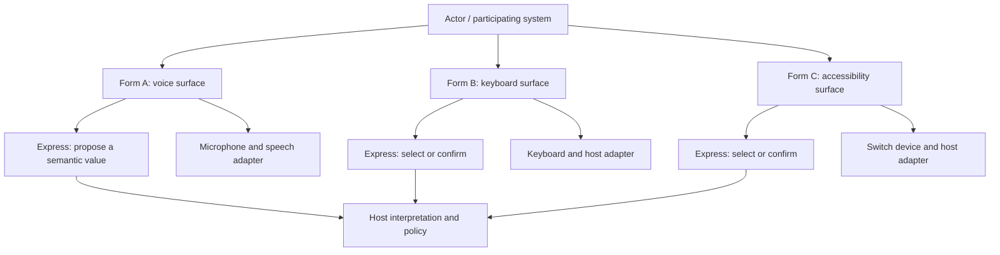

<!-- The Singularity Workshop moniker -->
<p align="center"><a href="https://github.com/TrentBest"></a></p>

# 02 — Actors, Forms, and Contextual Capabilities

## 1. Intuition: the participant is not the device

Imagine a person using a voice interface on a phone, then continuing the same task with a keyboard on a desktop. The participant has not changed, but the form through which the interaction is expressed has.

Now consider a robot. Its camera, microphone, wheels, gripper, and network connection are not separate actors merely because they are separate mechanisms. They are different capabilities and manifestations associated with a larger participating system.

An AI agent may similarly observe a document, propose an edit, and request a tool operation. The agent, its model, the tool connection, and the individual operations should not be collapsed into one undifferentiated “user.”

The useful questions are:

- **Actor:** which participating entity or system is involved?
- **Form:** through what representation or interface is it participating here?
- **Capability:** what can that form sense, express, or perform in this context?
- **Manifestation:** which physical, virtual, or software mechanism makes that capability available?

These are related concepts, not interchangeable names for a device.

## 2. Theory: actor, form, capability, manifestation

An **actor** is the participant whose interaction matters to the host. It may be a human, animal, robot, AI agent, service, or software process. “Actor” is a role in the interaction model, not a claim about personhood or trust.

A **form** is the participating representation through which an actor is available to a particular interaction. One actor can participate through multiple forms; a composite system can also expose several distinct forms. The form is contextual: a remote operator's voice channel and a robot's local control interface are not the same interaction surface even if they ultimately affect the same domain.

A **capability** describes a possible interaction direction:

- **Observe:** receive or sense information.
- **Express:** communicate or propose information.
- **Act:** perform an action.

A **manifestation** is the mechanism that realizes a capability: a keyboard, camera, microphone, gripper, browser surface, API connection, accessibility switch, or other physical or software mechanism.

Capability is always conditional in practice. A camera may be present but unavailable; a microphone may be disconnected; an API may be reachable only in a particular session; a robot arm may be mechanically capable of movement while the environment makes movement unsafe. A capability description is therefore not a promise of present availability unless the owning system has separately established that fact.

And capability is not authority. “Can perform” does not mean “may perform now.” The host remains responsible for policy, authorization, validation, and execution.

## 3. Model: the same actor can have several forms

The following is a conceptual model, not a class diagram of public FSM_UserIO types:



This picture deliberately does not say that FSM_UserIO creates actors, registers forms, discovers devices, negotiates capabilities, or binds manifestations. Those responsibilities remain with the source system, platform adapter, and host.

The model helps prevent two common mistakes:

1. **Device identity becomes actor identity.** Replacing a keyboard with speech should not require inventing a new application participant if the actor and relevant context are unchanged.
2. **Capability becomes permission.** Listing an actuator or an “Act” capability must not bypass host policy or environmental checks.

## 4. Implementation: what the current contracts represent

The current `development` source provides this capability value:

```csharp
public sealed record InteractionCapability(string Name, InteractionMode Mode);

public enum InteractionMode
{
    Observe = 0,
    Express = 1,
    Act = 2
}
```

The contract is intentionally small:

- `Name` is a required, non-whitespace, application-defined label and is preserved as supplied.
- `Mode` must be a defined enum value.
- `Observe`, `Express`, and `Act` describe the interaction direction.
- `Act` explicitly does not imply application authorization.

The current source also provides `InteractionContext`:

```csharp
public sealed record InteractionContext(
    Guid CorrelationId,
    string? ParticipantId = null,
    Guid? SessionId = null);
```

It carries a required non-empty correlation identifier and optional application-defined participant and session labels. It does not create an actor or form, authenticate a participant, manage a session, or establish a relationship between a capability and a device.

That distinction matters: **FSM_UserIO does not currently expose an Actor class, a Form class, a capability registry, a device model, or a capability-negotiation protocol.** Actor and form are domain concepts used to reason about the boundary. The implemented contracts carry a named capability and optional correlation context; they do not implement the whole conceptual model.

The following is illustrative host-owned pseudocode, not a UserIO API:

```csharp
// Pseudocode: the host owns actor/form records and capability discovery.
var form = host.ResolveActiveForm(actorId, sessionId);

if (form.Capabilities.Contains("camera.observe"))
{
    // Availability is checked by the platform adapter.
    var observation = cameraAdapter.TryObserve();

    if (observation is not null)
        host.Interpret(observation, form.Context);
}
```

The host must still decide whether the observation is relevant, whether its source is trusted, and what application meaning—if any—follows.

The published NuGet package `0.1.0-alpha.1` remains the earlier `SemanticIntent`-only API. `InteractionCapability` and `InteractionContext` are current development-source contracts, not APIs available to Alpha 1 package consumers.

## 5. Evidence and limits

The following tests exercise the implemented value contracts:

| Claim | Evidence | Limit |
|---|---|---|
| Each defined interaction mode is accepted and preserved | `Capability_preserves_name_and_defined_mode` in [SemanticInteractionTests.cs](../../tests/FSM_UserIO.Tests/SemanticInteractionTests.cs) | Does not discover a device or prove that the capability is currently available |
| Missing or whitespace-only capability names are rejected | `Capability_rejects_invalid_name` | Does not define a universal capability vocabulary |
| Undefined interaction modes are rejected | `Capability_rejects_undefined_mode` | Does not validate whether a named capability is truthful |
| Participant and session labels can be carried as optional context | `Context_allows_optional_participant_and_session_metadata`, `Context_defaults_optional_metadata_to_null` | Does not authenticate the participant or manage the session |
| Empty correlation/session identifiers and blank participant labels are rejected | `Context_rejects_empty_correlation_and_blank_participant` | Does not provide correlation storage, ordering, or lifecycle |

These are constructor and value-contract tests. They do not establish hardware discovery, capability negotiation, device availability, participant authentication, authorization, or execution.

For the exact constructor rules and non-guarantees, see [API Contracts](../API_CONTRACTS.md). For responsibility ownership across the full lifecycle, see [Interaction Lifecycle](../INTERACTION_LIFECYCLE.md).

## 6. Apply it

A remote operator controls a robot through a browser. The robot also has local sensors and an autonomous software process.

1. Is the browser the actor, or is it a manifestation through which the remote operator participates?
2. Does the robot's gripper being present mean the operator is allowed to use it?
3. If the browser disconnects, does that prove the operator no longer exists?
4. Which system should determine whether a proposed movement is safe and permitted?
5. Does an `InteractionContext.ParticipantId` prove that the message came from that participant?

**Review answers**

- The remote operator is the actor in this example; the browser is one manifestation/form through which the operator participates.
- No. The gripper's capability is not permission to use it.
- No. A connection ending is an observation about that manifestation, not proof that the actor ceased to exist.
- The host/application and its safety and authorization boundaries decide whether movement may proceed.
- No. The participant ID is an application-defined label carried in context, not authenticated identity.

The design rule is to model actors and forms where the host needs them, describe capabilities without turning them into authority, and keep platform mechanics outside the semantic core.

---

**Next:** [03 — Observation, Expression, Interpretation, and Intent](README.md#chapters) will separate what a source reports from what an application decides it means.

---

<!-- THE SINGULARITY WORKSHOP FOOTER -->
<p align="center"></p>
