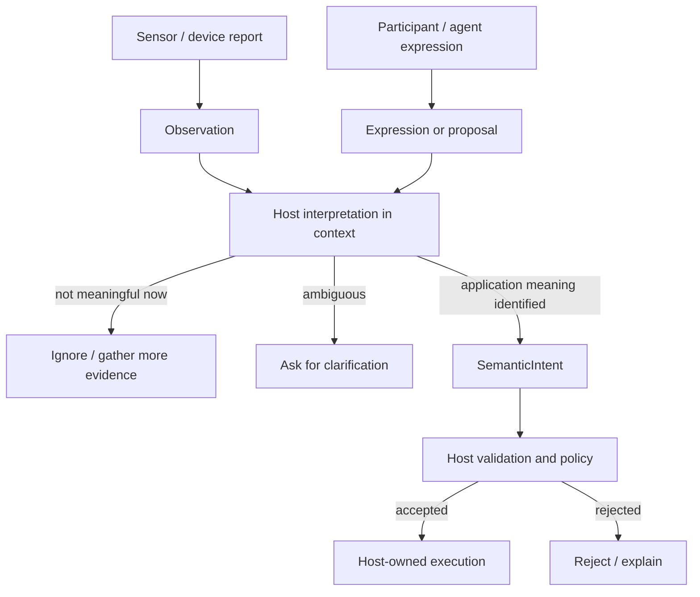

<!-- The Singularity Workshop moniker -->
<p align="center"><a href="https://github.com/TrentBest"></a></p>

# 03 — Observation, Expression, Interpretation, and Intent

## 1. Intuition: a report is not a decision

A camera reports motion. A microphone produces a speech-recognition proposal. A person says “open the door.” A software process emits a message saying that a file changed.

Each source has communicated something. None of those reports, by itself, decides what the application should do.

Motion might be a person entering, a curtain moving, or a sensor fault. “Open the door” might be a request, a quotation, a test phrase, or an instruction from an unauthorized participant. A file-change event might be relevant to one workflow and irrelevant to another.

The application must interpret source information in context. Sometimes it will produce a semantic intent. Sometimes it will ignore the input, combine it with other evidence, reject it, or ask for clarification.

## 2. Theory: four different stages

Keep these concepts separate:

- **Observation** — a source-neutral statement of something detected or reported. It describes what the source says it observed.
- **Expression** — something communicated or proposed by a participant or source. It may contain a request, suggestion, utterance, or other expression that still needs interpretation.
- **Interpretation** — the host/application's decision about what an observation or expression means in the current domain and context.
- **Intent** — an application-owned semantic value identifying the interaction the host has chosen to represent.

These stages do not form a mandatory one-to-one pipeline. An observation can be ignored. Several observations can inform one interpretation. One expression can be ambiguous. An interpretation can result in no intent, one intent, or a request for clarification. An intent can still be rejected by policy.

The essential ownership rule is that a source may report or propose; the application owns the meaning assigned to that report.

## 3. Model: evidence and proposals converge on host interpretation



This is a conceptual flow, not a claim that FSM_UserIO implements a recognizer, interpreter, policy engine, or executor. The contracts represent values at selected boundaries. The host supplies the transitions between them.

A useful example is voice input. A speech system may express the recognized phrase “delete the draft.” The host interprets it against the active document, the participant's context, and the application's vocabulary. Only then might the host create the intent `document.delete-draft`. Authorization and execution remain separate decisions.

## 4. Implementation: three value contracts, different responsibilities

The current `development` source includes these contracts.

### Observation

```csharp
public sealed record SemanticObservation(
    string Name,
    DateTimeOffset ObservedAt,
    string? Source = null,
    double? Confidence = null);
```

- `Name` is required, non-whitespace, and application-defined.
- `ObservedAt` is supplied by the producer and preserved; UserIO does not synchronize clocks or validate chronology.
- `Source` is optional descriptive metadata. It is not authenticated provenance.
- `Confidence` is optional, finite, and constrained to the inclusive range `[0, 1]`.

A valid confidence number is not automatically a calibrated probability, a quality guarantee, or a comparable score across different sources. The contract validates its numeric range, not the model or measurement that produced it.

### Expression

```csharp
public sealed record SemanticExpression(
    string Name,
    DateTimeOffset ExpressedAt,
    string? Source = null);
```

An expression has a required name, producer-supplied timestamp, and optional descriptive source label. It deliberately does not become a `SemanticIntent` automatically. The host owns interpretation.

### Intent

```csharp
public sealed record SemanticIntent(string Name, ulong? ProtocolId = null);
```

An intent carries application-owned meaning:

- `Name` is required and non-whitespace; the supplied value is preserved exactly.
- `ProtocolId` is optional and is an association value, not authentication or authorization.
- Equality is value-based and includes both properties.
- The contract does not map a source event to a name or execute the named operation.

The published NuGet package `0.1.0-alpha.1` exposes `SemanticIntent` only. `SemanticObservation` and `SemanticExpression` are current `development`-source contracts and are not part of the published Alpha 1 package.

### Host-owned interpretation (pseudocode)

```csharp
// Pseudocode: no such interpreter is provided by FSM_UserIO.
SemanticIntent? Interpret(
    SemanticObservation? observation,
    SemanticExpression? expression,
    InteractionContext context)
{
    if (expression?.Name == "request.open-document"
        && hostContext.HasSelectedDocument(context))
    {
        return new SemanticIntent("document.open");
    }

    return null; // No semantic intent was established.
}
```

The example intentionally leaves source validation, context resolution, vocabulary, and policy with the host. It does not claim that matching a string is sufficient for a real application.

## 5. Evidence and limits

| Claim | Evidence | Limit |
|---|---|---|
| Observation preserves its supplied name, timestamp, and source label | `Observation_preserves_timestamp_and_source_and_does_not_normalize` in [SemanticInteractionTests.cs](../../tests/FSM_UserIO.Tests/SemanticInteractionTests.cs) | Does not establish clock accuracy, chronology, or source identity |
| Confidence accepts 0, 0.5, and 1, and rejects out-of-range or non-finite values | `Observation_accepts_confidence_inclusive_range`, `Observation_rejects_invalid_confidence` | Does not calibrate confidence or compare sources |
| Blank observation/expression names and blank supplied source labels are rejected | `Observation_rejects_invalid_name`, `Expression_rejects_invalid_name`, `Observation_rejects_blank_source_when_supplied`, `Expression_rejects_blank_source` | Does not define a vocabulary or trust policy |
| An expression remains a distinct value rather than an intent | `Expression_is_not_an_intent_and_keeps_its_source_label` | Does not interpret an expression or decide what intent should follow |
| An intent preserves its application-defined identity and optional protocol association | `Intent_preserves_application_owned_identity`, `Intent_does_not_require_protocol_identity` in [SemanticIntentTests.cs](../../tests/FSM_UserIO.Tests/SemanticIntentTests.cs) | Does not infer an intent from an observation or expression |

The contracts do not define event ordering, deduplication, replay protection, source authentication, interpretation algorithms, semantic vocabulary governance, or authorization. Their timestamps and source labels are supplied data, not verified facts.

See [API Contracts](../API_CONTRACTS.md) for exact validation behavior and [Interaction Lifecycle](../INTERACTION_LIFECYCLE.md) for the broader ownership model.

## 6. Apply it

A warehouse camera reports `motion-detected`. A voice assistant expresses `move-the-pallet`. The host knows that the aisle is currently restricted.

1. Which value describes what the camera reported?
2. Which value describes the voice assistant's proposal before the host interprets it?
3. Who decides whether the proposal means a valid domain operation?
4. Can the host create an intent and still refuse to execute it?
5. Does an observation's `Source` label prove which camera produced it?
6. Does a confidence value of `0.99` prove the observation is correct?

**Review answers**

- `SemanticObservation` carries the source-neutral report.
- `SemanticExpression` carries the proposal.
- The host/application interprets both using domain context and its own vocabulary.
- Yes. Identifying an intent and authorizing its execution are separate decisions.
- No. The source label is descriptive metadata, not authenticated provenance.
- No. UserIO validates the numeric range only; it does not establish calibration or truth.

When designing an adapter, preserve what the source actually reported. Do not silently upgrade a report into application meaning. Let the host make that semantic decision explicitly.

---

**Next:** [04 — Capability Is Not Authority](README.md#chapters) will examine the separate boundaries for validation, authorization, policy, and execution.

---

<!-- THE SINGULARITY WORKSHOP FOOTER -->
<p align="center"></p>
