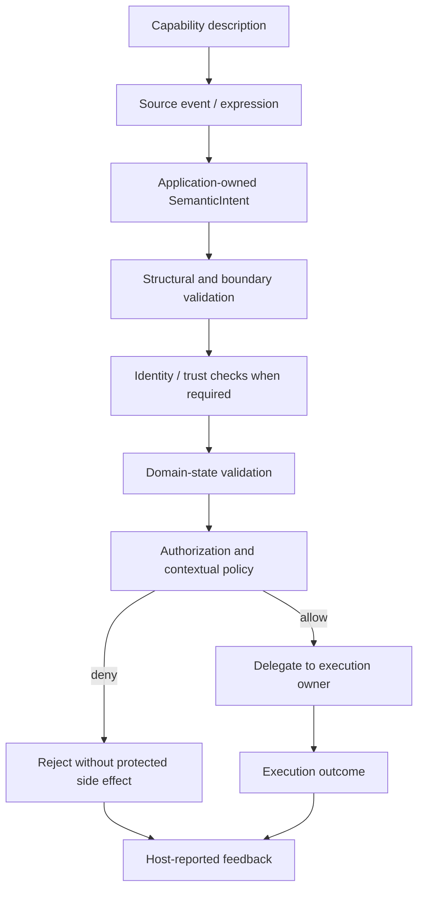

<!-- The Singularity Workshop moniker -->

# 04 — Capability Is Not Authority

A capability says what a form can do. Authority decides whether it may do it here, now, and under these conditions. Those are different questions, owned by different parts of a system.

This distinction is one of the most important safety boundaries in semantic interaction. A robot may have a motor, a user may be able to press a delete button, and an AI agent may be able to formulate a tool request. None of those facts grants permission to cause the corresponding effect.

## 1. Intuition: having a key is not being allowed through the door

Imagine a building with a door and an access-control desk.

- The door hardware can physically unlock. That is a capability.
- A badge presents an identity claim. That is evidence to be checked, not permission by itself.
- The access system checks whether the identity is trusted. That is authentication.
- The access rules decide whether this person may enter this room at this time. That is authorization and policy.
- The lock actually releases. That is execution.
- A light or message reports what happened. That is feedback.

A door that can unlock should not unlock merely because somebody asks it to. Likewise, an interaction form that advertises an action should not be treated as an authority to perform it.

## 2. The distinctions

These terms are related, but they are not interchangeable.

| Concern | Question | Typical owner |
|---|---|---|
| Capability description | What can this form or adapter sense, express, or perform? | Form, source system, or host |
| Structural validation | Is this value well-formed according to its contract? | Value contract / boundary |
| Authentication | Who or what produced this request, and how was that established? | Identity and trust boundary |
| Domain validation | Does the requested operation make sense for the current domain state? | Domain / application |
| Authorization | Is this authenticated principal permitted to perform this operation on this resource? | Host / security policy |
| Contextual policy | Is it permitted under current experience, state, risk, time, and other rules? | Host / application |
| Execution | What component performs the authorized operation and owns its side effects? | Domain runtime / execution owner |
| Feedback | What does the producer report about the decision or outcome? | Host and chosen presentation surface |

A request can pass one check and fail another. A well-formed request can be unauthorized. An authenticated user can request an operation that is invalid in the current domain state. An authorized operation can still fail during execution.

The checks are not a universal mandatory pipeline with one prescribed ordering. A host chooses the controls appropriate to its threat model and domain. The table names distinct responsibilities so that one successful check is not mistaken for all the others.

## 3. A model of the boundary

This is an explanatory model, not a public FSM_UserIO workflow or a promise that every application must implement these exact stages. In particular, FSM_UserIO does not provide the authentication, authorization, policy engine, or execution nodes shown here.

The critical invariant is:

**Describing an action, naming an intent, or validating its shape must never be treated as permission to perform it.**

## 4. What FSM_UserIO actually guarantees

The current `development` source provides small value contracts around interaction:

- `InteractionCapability(Name, Mode)` describes an application-defined capability and whether it concerns `Observe`, `Express`, or `Act`.
- `SemanticIntent(Name, ProtocolId)` carries application-owned semantic meaning.
- `InteractionContext` carries a non-empty correlation identifier and optional application-owned participant/session labels.
- `SemanticFeedback` carries a correlation identifier, a feedback kind, and a message.
- `SemanticObservation`, `SemanticExpression`, and `SemanticPayload` carry source-neutral descriptive values.

The `InteractionMode.Act` member is deliberately explicit: the form describes an ability to perform an action; this does not imply application authorization. The constructor validates that the mode is a defined enum value and that the capability name is non-whitespace. That is structural validation, not a security decision.

Likewise:

- A non-empty `SemanticIntent.Name` is not proof that the named operation exists.
- An optional `ProtocolId` is an association, not authenticated identity or permission.
- `InteractionContext.ParticipantId` is a caller-supplied label, not proof of who is participating.
- A source label on an observation or expression is metadata, not authenticated provenance.
- `SemanticFeedback(…, FeedbackKind.Accepted, …)` is a producer's report, not an independently verified authorization record.
- `FeedbackKind.Completed` does not prove that an external observer can verify the claimed side effect.

These types carry data. They do not decide whether that data should be trusted or acted upon.

The published NuGet package `0.1.0-alpha.1` remains the earlier `SemanticIntent`-only baseline. The expanded contracts described above are present on `development`; do not infer that they are already available to consumers of the published package.

## 5. Validation is not authorization

The distinction is easiest to see with a destructive operation.

A host might receive an intent named `account.delete`. Several independent questions remain:

1. Is the intent value structurally valid?
2. Does the host recognize this semantic name in this application?
3. Is the current account state eligible for deletion?
4. Is the requesting principal authenticated to the required standard?
5. Is that principal authorized to delete this account?
6. Do current policy rules require confirmation, elevated authentication, or a waiting period?
7. Which domain service owns deletion, and can it perform the operation safely?
8. What outcome can the host truthfully report?

FSM_UserIO answers none of those domain or security questions. It can carry the intent across a platform-neutral boundary; the host must resolve the questions before delegating side effects.

A common category error is to treat constructor validation as a security gate. Rejecting a blank name or undefined enum prevents malformed values from entering a contract. It does not establish who supplied the value, whether the caller is trusted, whether the operation is allowed, or whether the operation is safe.

## 6. A concrete example from the published consumer sample

The [runnable Alpha 1 host sample](../../samples/SemanticIntentHostSample/README.md) maps console keys to application-owned intents:

- `S` becomes `open-settings`.
- `D` becomes `delete-account`.
- The host's `HostAccepts` allowlist accepts only `open-settings`.

The sample therefore demonstrates the central separation: the adapter can create a valid `delete-account` intent, while the host can still deny it. The sample intentionally does not implement a production identity system, domain authorization service, or account deletion operation. It is a small illustration of host ownership, not a complete security architecture.

The sample's allowlist is application code. It is not an FSM_UserIO API.

## 7. Who owns what in the Workshop

- **FSM_UserIO** carries semantic interaction values and descriptive capability/context/feedback data. It does not authorize or execute.
- **ProtocolAi** may supply deterministic identity for application-owned symbols. An identifier does not authenticate its presenter or grant permission.
- **GrammarAi** may describe structural composition. A well-formed structure is not a policy decision.
- **GUI and platform adapters** present or translate interaction. A UI control being visible or enabled is not a substitute for server/host-side authorization.
- **The host/application** owns identity integration, domain validation, authorization, contextual policy, and the decision to delegate an operation.
- **The execution owner** performs the operation and owns its side effects. In the Hub workflow, Foundry owns the authoritative workflow execution pipeline and run state.

These are responsibility boundaries. They do not imply direct package dependencies.

## 8. Evidence and limits

The current source and tests establish the following narrow behavior:

| Evidence | What it verifies | What it does not verify |
|---|---|---|
| `SemanticInteractionTests.Capability_preserves_name_and_defined_mode` | A defined capability mode and valid name are preserved | That a capability is available, trusted, or authorized at runtime |
| `SemanticInteractionTests.Capability_rejects_invalid_name` | Blank or null capability names are rejected | Authentication or permission |
| `SemanticInteractionTests.Capability_rejects_undefined_mode` | Undefined enum values are rejected | Whether an action is safe or permitted |
| `SemanticInteractionTests.Context_rejects_empty_correlation_and_blank_participant` | Invalid context identifiers/labels are rejected | Participant identity or session ownership |
| `SemanticInteractionTests.Feedback_preserves_kind_message_and_correlation` | Feedback values are carried as supplied | Whether the reported acceptance or completion is true |
| `SemanticInteractionTests.Feedback_rejects_invalid_correlation_kind_and_message` | Invalid feedback structure is rejected | Authorization, execution, or audit integrity |

The [API contracts](../API_CONTRACTS.md), [interaction lifecycle](../INTERACTION_LIFECYCLE.md), and [architecture](../ARCHITECTURE.md) describe the current ownership boundary in more detail.

The current core does not implement:

- authentication, identity proof, or source attestation;
- authorization, role/permission evaluation, or access-control lists;
- a policy engine or contextual risk evaluation;
- domain-state validation;
- command dispatch or protected side effects;
- an authoritative audit log or tamper-evident decision record;
- a guarantee that feedback is truthful or that an operation completed.

Do not read these absences as a request to add them to UserIO. They are host/application concerns unless a concrete, reusable, platform-neutral consumer requirement demonstrates otherwise.

## 9. Apply it

Consider a remote robot-control form that advertises `robot.move` with `InteractionMode.Act`.

1. The capability tells the host that the form claims it can express a movement action. Does that establish that the robot is connected?
2. A request arrives with a valid `SemanticIntent`. Does that establish who sent it?
3. The sender is authenticated. Does that establish that the sender may move this robot?
4. The sender is authorized, but an emergency stop is active. Should the host execute?
5. The host denies the request and emits `SemanticFeedback` with kind `Rejected`. Does the feedback type itself enforce the denial?

The answer to each question is no: each is a separate responsibility. The host evaluates the relevant conditions; the execution owner remains responsible for enforcing the operation boundary. Feedback communicates the host's report but does not enforce policy.

### Review questions

- Why is `InteractionMode.Act` descriptive rather than permissive?
- What does constructor validation protect against, and what does it not establish?
- Why are `ParticipantId`, `Source`, and `ProtocolId` insufficient as authentication evidence?
- Why should a host-side denial prevent delegation to the component that owns the side effect?
- Which package or application boundary should own a proposed authorization feature?

---

**Next:** [05 — Protocol Identity, Grammar, and Application Meaning](README.md#chapters) will separate deterministic symbol identity and structural grammar from application meaning and authority.

---

<!-- THE SINGULARITY WORKSHOP FOOTER -->

