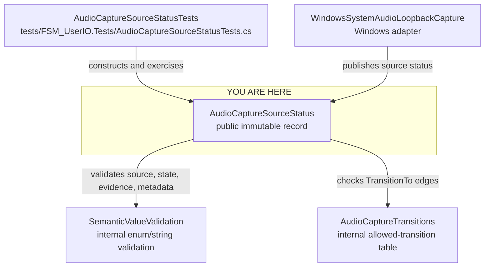

<!-- The Singularity Workshop moniker -->

# Class neighborhood: `AudioCaptureSourceStatus`

**Evidence classification:** source-derived relationships, human-authored view.  
**Revision scope:** `development`; see linked source and tests for the current implementation.  
**Purpose:** show the immediate consumers and implementation dependencies of the source-neutral audio status value. This is not a runtime call trace or a complete repository dependency graph.

## Neighborhood

The focal type is centered. Its test suite is shown above as a consumer. Its direct validation and transition collaborators are below. The Windows adapter is now included as a second consumer because its implementation directly constructs, exposes, and publishes this status type.

## Relationship notes

| Position | Type / artifact | Relationship | Evidence |
|---|---|---|---|
| Consumer | `AudioCaptureSourceStatusTests` | Constructs statuses, calls `TransitionTo`, and asserts lifecycle, immutability, validation, and failure behavior. | [Test source](../../../tests/FSM_UserIO.Tests/AudioCaptureSourceStatusTests.cs) |
| Consumer | `WindowsSystemAudioLoopbackCapture` | Constructs the system-audio status, exposes it through `Status`, and raises `StatusChanged` as lifecycle changes. | [Windows adapter source](../../../src/FSM_UserIO.WindowsAudio/WindowsSystemAudioLoopbackCapture.cs) |
| Focal type | `AudioCaptureSourceStatus` | Public sealed record; retains source identity and returns a new value for an allowed transition. | [Implementation](../../../AudioCaptureSourceStatus.cs) |
| Dependency | `SemanticValueValidation` | Validates defined enum values and optional non-whitespace metadata. | [Implementation](../../../AudioCaptureSourceStatus.cs) |
| Dependency | `AudioCaptureTransitions` | Internal finite transition table used by `TransitionTo`. | [Implementation](../../../AudioCaptureSourceStatus.cs) |

## Boundary and interpretation

- The record is a value contract, not an audio-capture engine.
- The status distinguishes microphone and system audio; one source's failure does not determine the other's state.
- `Observed` and `HostReportedEstimate` distinguish evidence quality. An estimate does not prove that acquisition will succeed.
- A `Ready` or `Capturing` state is not application authorization.
- The record contains no native endpoint, operating-system handle, browser object, stream, or buffer ownership.
- The Windows adapter consumes this contract but owns all NAudio/WASAPI resources in its separate `net8.0-windows` project.
- The transition table is finite and independent of collection size. No latency or runtime benchmark is implied by this diagram.

## Related views

- [Type reference and complete state model](../Types/AudioCaptureSourceStatus.md)
- [UML and source-documentation inventory](../README.md)
- [Audio capture source contract](../../AUDIO_CAPTURE_CONTRACT.md)
- [Windows system-audio loopback architecture and verification status](../../WINDOWS_SYSTEM_AUDIO_LOOPBACK.md)

---

<!-- THE SINGULARITY WORKSHOP FOOTER -->

