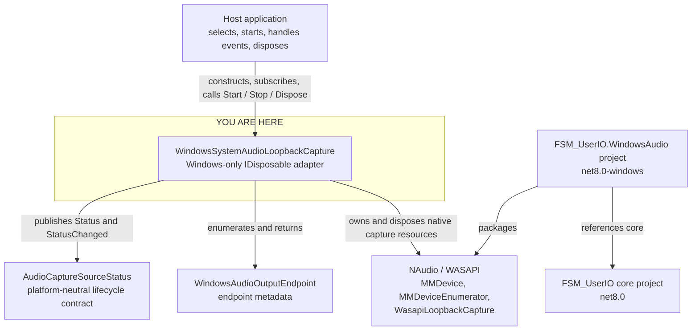

<!-- The Singularity Workshop moniker -->

# Class neighborhood: `WindowsSystemAudioLoopbackCapture`

**Evidence classification:** source-derived relationships, human-authored view.  
**Revision scope:** `development`; links below identify the implementation and project boundary.  
**Purpose:** show the Windows adapter's immediate contract, endpoint metadata, and native-library collaborators. This is not a runtime call trace or a claim of hardware verification.

## Neighborhood

The focal adapter owns Windows loopback capture and native resource lifetime. It reports lifecycle through the platform-neutral `AudioCaptureSourceStatus`, returns endpoint metadata through `WindowsAudioOutputEndpoint`, and uses NAudio/WASAPI internally. The project reference points inward to the core library; the core project does not acquire a Windows dependency.

## Relationship notes

| Position | Type / artifact | Relationship | Evidence |
|---|---|---|---|
| Consumer | Host application | Chooses default or endpoint ID, subscribes to audio/status events, controls lifecycle, and owns disclosure/policy. | Adapter public API and XML documentation |
| Focal type | `WindowsSystemAudioLoopbackCapture` | Enumerates endpoints, starts WASAPI loopback, copies callback buffers, maps lifecycle, and releases resources. | [Implementation](../../../src/FSM_UserIO.WindowsAudio/WindowsSystemAudioLoopbackCapture.cs) |
| Contract collaborator | `AudioCaptureSourceStatus` | Adapter exposes current status and raises status-change events using the source-neutral record. | [Core implementation](../../../AudioCaptureSourceStatus.cs) |
| Returned metadata | `WindowsAudioOutputEndpoint` | Carries endpoint ID, friendly name, and default-endpoint flag without exposing NAudio types. | [Endpoint metadata](../../../src/FSM_UserIO.WindowsAudio/WindowsAudioOutputEndpoint.cs) |
| Native dependency | NAudio 2.2.1 / WASAPI | Supplies endpoint enumeration, loopback capture, callback buffers, and native resource objects. | [Adapter project file](../../../src/FSM_UserIO.WindowsAudio/FSM_UserIO.WindowsAudio.csproj) |

## Boundary and interpretation

- The adapter is Windows-specific; the core semantic contract remains platform-neutral.
- The adapter captures system playback only. It does not capture a microphone or mix sources.
- Audio buffers are copied before being raised to consumers; reported sample format is forwarded without conversion.
- The host remains responsible for disclosure, consent, recording-mode policy, and application authorization.
- Endpoint enumeration and endpoint-ID selection are implemented in source. This diagram does not establish that device-removal recovery, acquisition cancellation, or real hardware capture has been verified.
- The documented status is **implemented prototype; hardware verification pending**. A successful compile is not evidence of real endpoint capture.
- No unit-test class is shown as a consumer here: a dedicated Windows adapter test suite was not verified in the inspected paths.

## Related views

- [Audio capture source status neighborhood](AudioCaptureSourceStatus.md)
- [Windows loopback architecture and verification gate](../../WINDOWS_SYSTEM_AUDIO_LOOPBACK.md)
- [Audio capture source contract](../../AUDIO_CAPTURE_CONTRACT.md)
- [UML and source-documentation inventory](../README.md)

---

<!-- THE SINGULARITY WORKSHOP FOOTER -->

