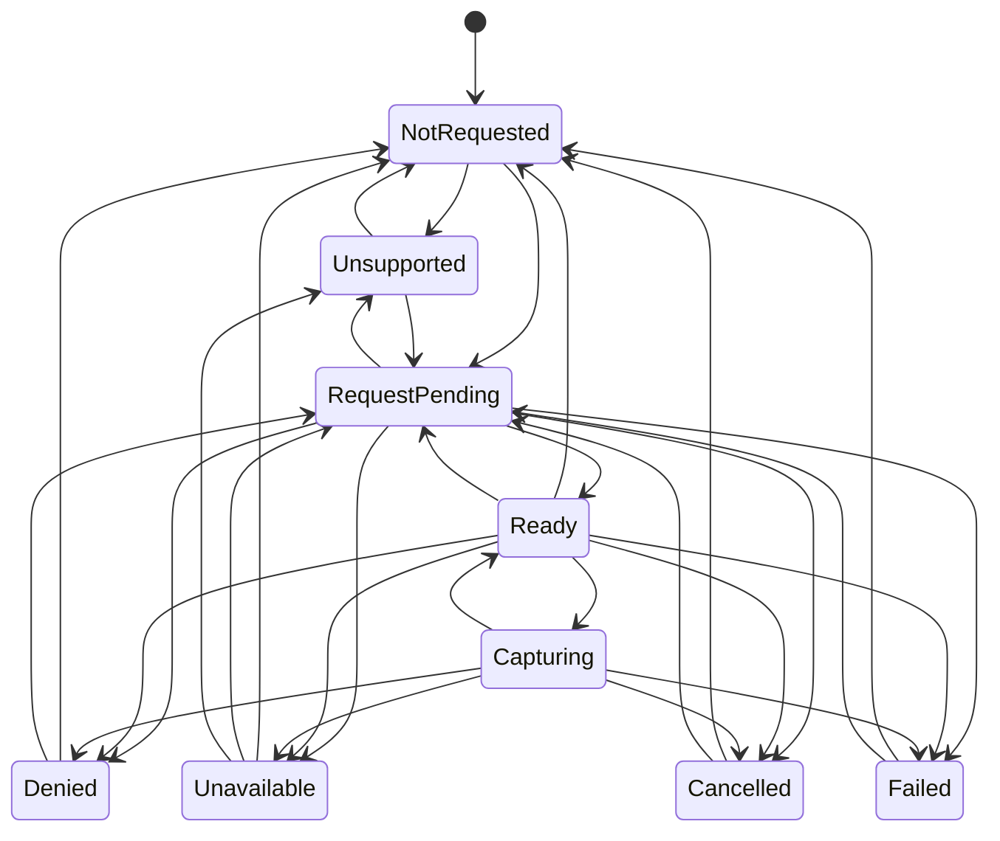
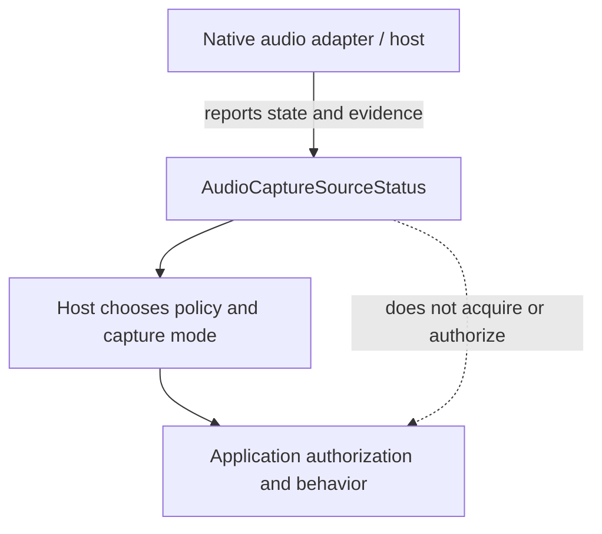

<!-- The Singularity Workshop moniker -->
<p align="center"><a href="https://github.com/TrentBest"></a></p>

# Type reference: `AudioCaptureSourceStatus`

**Evidence classification:** source-derived contract and transition table, human-authored explanation.  
**Source:** [`AudioCaptureSourceStatus.cs`](../../../../AudioCaptureSourceStatus.cs) · **Tests:** [`AudioCaptureSourceStatusTests.cs`](../../../../tests/FSM_UserIO.Tests/AudioCaptureSourceStatusTests.cs)  
**Scope checked:** source and tests at `development`; this page is not generated UML and does not claim runtime-captured evidence.

## Purpose

`AudioCaptureSourceStatus` describes the state of one audio source without importing browser, operating-system, or device-SDK types. Microphone and system audio are independent values. The status describes observed or host-estimated readiness; it does not acquire audio, grant permission, or decide whether a host's chosen mode is satisfied.

```csharp
public sealed record AudioCaptureSourceStatus(
    AudioCaptureSourceKind Source,
    AudioCaptureSourceState State,
    AudioCaptureStateEvidence Evidence = AudioCaptureStateEvidence.Observed,
    string? ErrorCode = null,
    string? RecoveryGuidance = null);
```

## State model



The diagram mirrors `AudioCaptureTransitions.IsAllowed` in source. It is source-derived, not a trace of a particular browser or Windows adapter. A transition not listed is rejected by `TransitionTo` with `InvalidOperationException`.

## Values and invariants

| Member | Contract |
|---|---|
| `Source` | Defined `AudioCaptureSourceKind`: `Microphone` or `SystemAudio` |
| `State` | Defined lifecycle state: `NotRequested`, `Unsupported`, `RequestPending`, `Denied`, `Unavailable`, `Ready`, `Capturing`, `Cancelled`, or `Failed` |
| `Evidence` | `Observed` or `HostReportedEstimate`; estimates are not proof that acquisition will succeed |
| `ErrorCode` | Optional source-neutral non-whitespace diagnostic |
| `RecoveryGuidance` | Optional source-neutral non-whitespace guidance |

The record is immutable. `TransitionTo` validates enum values and the transition, then returns a new status while retaining the source kind. It does not mutate the prior status. A source-neutral error code or guidance string must not leak platform-specific types or OS handles.

## Ownership boundary



Each source has its own status. A microphone denial does not imply system audio is unavailable, and a ready source does not imply application authorization. The adapter owns native resource lifecycle; the host owns policy for partial success and mode selection.

## Verification evidence

The tests cover independent source values, a successful request-to-capture-to-ready path, source-neutral diagnostics, cancellation and retry, distinction between estimates and direct observations, partial success across sources, invalid transitions, undefined enum values, whitespace diagnostics, and source loss or permission revocation during capture.

## Complexity and measurement

The transition decision is a finite switch over the current state and does not depend on collection size. No runtime benchmark is claimed. Adapter acquisition, operating-system behavior, capture latency, and resource cleanup are outside this value contract and require separate platform-specific evidence.

## Related operational guides

- [Audio capture source contract](../../AUDIO_CAPTURE_CONTRACT.md)
- [Windows system-audio loopback decision](../../WINDOWS_SYSTEM_AUDIO_LOOPBACK.md)
- [Audio capture verification guide](../../demos/AUDIO_CAPTURE_TESTING.md)
- [UML/source-documentation inventory](../README.md)


<!-- THE SINGULARITY WORKSHOP FOOTER -->
<p align="center"></p>
