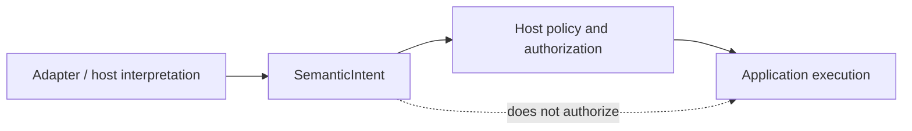

<!-- The Singularity Workshop moniker -->
<p align="center"><a href="https://github.com/TrentBest"></a></p>

# Type reference: `SemanticIntent`

**Evidence classification:** source-derived contract, human-authored explanation.  
**Source:** [`SemanticIntent.cs`](../../../SemanticIntent.cs) · **Tests:** [`SemanticIntentTests.cs`](../../../tests/FSM_UserIO.Tests/SemanticIntentTests.cs)  
**Published boundary:** package `0.1.0-alpha.1` includes this contract; this page describes the source contract on `development`.  
**Scope checked:** source and tests at `development`; this page does not claim reflection-generated coverage.

## Purpose

`SemanticIntent` is a small, application-owned value describing semantic meaning such as `open-settings` or `select`. It carries meaning across the UserIO boundary without representing a physical device event or granting execution authority.

```csharp
public sealed record SemanticIntent(string Name, ulong? ProtocolId = null);
```

## Contract

| Member | Meaning | Invariant |
|---|---|---|
| `Name` | Application-defined semantic name | Must not be null, empty, or whitespace-only; valid text is preserved as supplied |
| `ProtocolId` | Optional numeric protocol association | May be absent; when present, any `ulong` value is accepted |

The type is a sealed record, so equality is value-based and includes both members. The name comparison is case-sensitive. It does not trim or case-normalize valid names.

## Semantic boundary



`ProtocolId` is only an association value. UserIO does not allocate it, resolve its namespace, authenticate a sender, prove trust, or authorize an operation. Applications using multiple protocol namespaces must supply their own scope outside this type.

## Validation and observable behavior

- Construction rejects names consisting entirely of whitespace, including Unicode whitespace recognized by the runtime.
- A valid name is preserved exactly; case changes remain distinct values.
- An absent protocol ID is valid.
- Equal values produce equal hash codes under the record contract.
- No execution, transport, persistence, ordering, deduplication, or replay guarantees are implied.

## Complexity and resource behavior

The type performs no I/O and maintains no shared state. Construction validates the name and assigns the two values. Exact runtime cost is not benchmarked here; no numeric complexity or allocation claim is made. Record equality and hashing depend on the member types and string contents.

## Verification evidence

The source-linked tests cover application-owned identity, omitted protocol identity, additional Unicode whitespace rejection, value equality/hash consistency, and case-sensitive name comparison. These tests establish the listed behaviors, not authorization safety of a consuming application.

## Related contracts

- [API contract inventory](../../API_CONTRACTS.md)
- [Onboarding](../../ONBOARDING.md)
- [UML/source-documentation inventory](../README.md)


<!-- THE SINGULARITY WORKSHOP FOOTER -->
<p align="center"></p>
