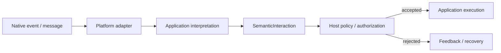

<!-- The Singularity Workshop moniker -->
<p align="center"><a href="https://github.com/TrentBest"></a></p>

# Type reference: `SemanticInteraction`

**Evidence classification:** source-derived contract, human-authored explanation.  
**Source:** [`SemanticInteraction.cs`](../../../SemanticInteraction.cs) · **Tests:** [`SemanticInteractionTests.cs`](../../../tests/FSM_UserIO.Tests/SemanticInteractionTests.cs)  
**Published boundary:** development-source contract; not included in published package `0.1.0-alpha.1`.  
**Scope checked:** `development` source and tests; no reflection-generated coverage is claimed.

## Purpose

`SemanticInteraction` is the source-neutral envelope a host can pass through its interaction-policy boundary. It groups an application-interpreted `SemanticIntent` with correlation context and optional evidence from the source adapter.

A browser keyboard event, pointer event, touch gesture, accessibility action, voice expression, or software message can be translated by its own adapter and represented by the same envelope. The envelope does not make those source mechanisms part of the core API.

## Contract

```csharp
public sealed record SemanticInteraction(
    SemanticIntent Intent,
    InteractionContext Context,
    SemanticObservation? Observation = null,
    SemanticExpression? Expression = null,
    SemanticPayload? Payload = null);
```

| Member | Meaning | Invariant |
|---|---|---|
| `Intent` | Application-owned semantic meaning | Required; null is rejected |
| `Context` | Correlation and optional participant/session metadata | Required; null is rejected |
| `Observation` | Optional source observation | Optional descriptive evidence; not authenticated provenance |
| `Expression` | Optional expression or proposal | Optional; not automatically interpreted or trusted |
| `Payload` | Optional opaque application-owned bytes | Optional; payload semantics remain with the application |

The type is an immutable sealed record with value equality. It retains the supplied contract instances; the payload itself provides defensive byte-copy semantics.

## Interaction boundary



The adapter owns native event mechanics. The application chooses the semantic name. UserIO carries the resulting interaction. The host owns domain validation, authorization, side effects, and execution.

## Explicit non-guarantees

`SemanticInteraction` does not:

- subscribe to keyboard, mouse, pointer, touch, voice, or device events;
- map native event names to application intents;
- infer intent from an observation or expression;
- queue, dispatch, order, deduplicate, replay, or persist interactions;
- authenticate the source or prove that optional evidence is trustworthy;
- validate domain state, authorize an action, or execute a command;
- create or manage participant/session lifecycles.

Those responsibilities remain with the adapter, application, host, or a separately justified capability.

## Verification evidence

The source-linked tests verify:
- required intent and context null guards;
- preservation of optional observation, expression, and payload references;
- a minimal intent/context-only envelope;
- record value equality and consistent hash codes.

These tests verify the value contract, not a live browser-to-domain workflow. The latter requires a consuming host integration and its own acceptance/denial/no-side-effect tests.

## Related contracts

- [SemanticIntent](SemanticIntent.md)
- [InteractionContext](InteractionContext.md)
- [SemanticObservation](SemanticObservation.md)
- [SemanticExpression](SemanticExpression.md)
- [SemanticPayload](SemanticPayload.md)
- [API contract inventory](../../API_CONTRACTS.md)
- [Interaction lifecycle](../../INTERACTION_LIFECYCLE.md)
- [UML/source-documentation inventory](../README.md)

---

<!-- THE SINGULARITY WORKSHOP FOOTER -->
<p align="center"></p>
