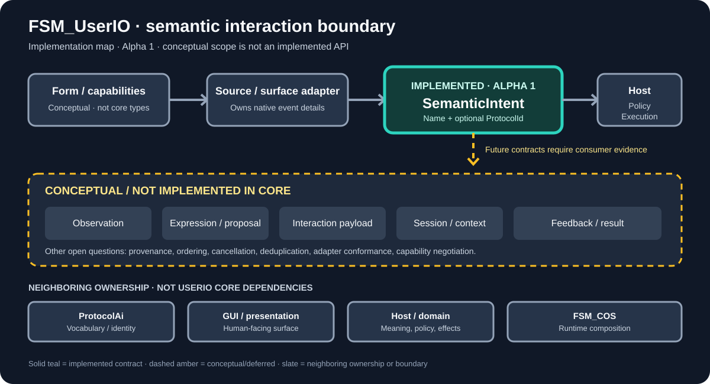

  

# Semantic interaction across forms

FSM_UserIO defines a platform-neutral boundary for what an interacting form can **sense**, **express**, and **do**—without confusing capability with observation, intent, authority, or execution.

It is not a GUI framework, a device-input library, or a command executor. It supplies semantic interaction primitives that hosts and adapters can use while policy and authoritative execution remain outside the package.

[Source repository](https://github.com/TrentBest/FSM_UserIO) · [NuGet package](https://www.nuget.org/packages/TheSingularityWorkshop.FSM_UserIO) · [Report an issue](https://github.com/TrentBest/FSM_UserIO/issues)

## Begin here

- [Onboarding](ONBOARDING.md) — install the published package and run a consumer.
- [Theory](THEORY.md) — the conceptual model and its boundaries.
- [Architecture](ARCHITECTURE.md) — contracts, adapters, hosts, and ownership.
- [API contracts](API_CONTRACTS.md) — invariants, guarantees, and non-guarantees.
- [Integration walkthrough](INTEGRATION_WALKTHROUGH.md) — connect a host without transferring authority.
- [Gallery](GALLERY.md) — diagrams, examples, and visual explanations.

## The domain at a glance

An interaction is evidence and intent—not permission. Hosts own policy and authorization; FSM_Foundry owns authoritative workflow execution.

## Concepts and implementation

| Area | Guide |
|---|---|
| Interaction lifecycle | [Lifecycle and state transitions](INTERACTION_LIFECYCLE.md) |
| Audio capabilities | [Audio capture contract](AUDIO_CAPTURE_CONTRACT.md) |
| Windows audio adapter | [Windows system-audio loopback](WINDOWS_SYSTEM_AUDIO_LOOPBACK.md) |
| Ownership boundaries | [Ownership matrix](OWNERSHIP_MATRIX.md) |
| Development | [Contributor and development guide](DEVELOPMENT.md) |
| Implementation plan | [Implementation roadmap](IMPLEMENTATION_ROADMAP.md) |
| Completion criteria | [Domain completion criteria](DOMAIN_COMPLETION_CRITERIA.md) |

## Learning paths and demonstrations

- [Theory chapters](THEORY/README.md)
- [UML diagrams](UML/)
- [Interactive Audio Capture Lab](demos/audio-capture-lab.html)
- [Audio Capture Lab verification](demos/AUDIO_CAPTURE_TESTING.md)

## Release status

The published NuGet package remains **0.1.0-alpha.1** and exposes the original SemanticIntent contract. The expanded contracts documented on the development site describe the current source branch and are not represented as already released package APIs. Package publication remains a separate, explicitly gated operation.

---

[View the source and contribute](https://github.com/TrentBest/FSM_UserIO) · [Workshop](https://github.com/TrentBest)
